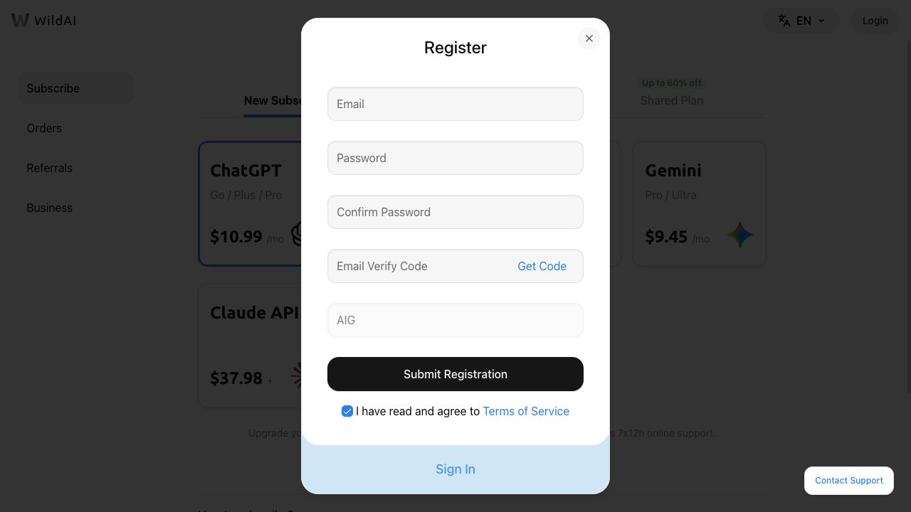

# 2026 ChatGPT 订阅指南：国内如何订阅 ChatGPT Plus（价格、支付方式与避坑）

想订阅 ChatGPT Plus，却卡在选套餐、银行卡被拒或付款后没升级？这份中文指南把 **官方价格、购买渠道、付款排查、取消退款与第三方服务**放在一起，方便按问题查找。需要用 Codex 的，也可以先比较 Plus 与 Pro 的用量规则。

📅 本次更新：**2026-10-28** ｜ 已重新核对个人套餐、Plus 说明、WildAI 公开订阅卡片与隐私条款；各项来源和核对范围见 [SOURCES.md](SOURCES.md)。

**⚠️ 本项目和 OpenAI 没有任何关系。不提供网络访问、账号共享、地区规避，也不会找你要密码。**

---

## ChatGPT 新手图文教程

从注册、下载到订阅，按需要选择对应教程：

- [ChatGPT 邮箱注册教程](guides/chatgpt-register.md)
- [安卓与 iPhone 下载教程](guides/chatgpt-download-mobile.md)
- [Windows 与 Mac 下载教程](guides/chatgpt-download-desktop.md)

## 目录

- [30 秒看懂：ChatGPT Plus 怎么订阅](#30-秒看懂chatgpt-plus-怎么订阅)
- [国内订阅完整指南](guides/chatgpt-plus-china-guide.md)
- [ChatGPT Go、Plus 与 Pro 当前价格](#chatgpt-goplus-与-pro-当前价格)
- [三类订阅方式怎么选](#三类订阅方式怎么选)
- [方式一：官方网页订阅](#方式一官方网页订阅)
- [方式二：Apple 应用内订阅](#方式二apple-应用内订阅)
- [方式三：第三方支付协助服务](#方式三第三方支付协助服务)
- [没有海外支付条件怎么办](#没有海外支付条件怎么办)
- [ChatGPT 付款失败排查](#chatgpt-付款失败排查)
- [已扣款但没有升级怎么办](#已扣款但没有升级怎么办)
- [WildAI 适合哪些用户](#wildai-适合哪些用户)
- [WildAI 操作流程与邀请码](#wildai-操作流程与邀请码)
- [订阅前安全检查](#订阅前安全检查)
- [常见问题 FAQ](#常见问题-faq)
- [取消订阅与退款](#取消订阅与退款)
- [来源、更新记录与推广披露](#来源更新记录与推广披露)

---

## 30 秒看懂：ChatGPT Plus 怎么订阅

ChatGPT Plus 官方价格是 **20 美元一个月**，按月扣费，API 用量另算，不包含在 Plus 里面。

如果你的账号、所在地区和银行卡都符合 OpenAI 的要求，最好的选择就是直接去官网付款，没有中间商、没有溢价，退款也走官方流程，没什么好纠结的。

但现实是，很多国内用户仍会遇到支付失败。OpenAI 的支付风控可能核验发卡行地区；国内银行发行的卡，甚至部分香港发行的 Visa 或 Mastercard，也可能因为地区或支付方式不受支持而被拒绝。

付不了怎么办？目前主流的替代方案有两条路：

1. 在账户地区、实际所在地与付款条件符合要求时，通过官方 App 内购订阅；礼品卡并非所有账户都能使用；
2. 使用第三方服务，例如 [WildAI](https://bewild.ai/?code=1103)，直接通过微信或支付宝付款，将自己的 Free 账号订阅成 Plus 或 Pro。

官方入口：[ChatGPT](https://chatgpt.com/) · [OpenAI 当前定价说明](https://learn.chatgpt.com/zh-Hans/docs/pricing) · [WildAI 微信/支付宝订阅入口](https://bewild.ai/?code=1103)

---

## ChatGPT Go、Plus 与 Pro 当前价格

以下个人套餐参考核对于 **2026 年 10 月 28 日**，按美国美元月付口径整理。税费、本地币种、App 内购价格与可用档位，以自己的结算页为准。

| 套餐 | 月费参考 | 选择时重点看什么 |
| --- | ---: | --- |
| Free | $0 | 先体验任务是否适合使用 ChatGPT / Codex |
| Go | $8 | 日常使用和轻量任务，先确认高级功能是否满足需要 |
| Plus | $20 | 更高的模型和工具用量，适合日常工作与阶段性编程 |
| Pro 100 | $100 | Plus 用量长期不足时评估的 Pro 入门档 |
| Pro 200 | $200 | 套餐用量高于 Pro 100 |
| Pro 500 | $500 | Pro 三档中最高用量，并包含 Ultrafast |

### Plus 与 Pro 怎么选？

先实际使用 Plus 并观察用量面板，确认哪项限制影响任务，再比较升级和补充 credits 的成本。Pro 的各模型仍可能有单独限额，不等于所有功能无限使用。

**Codex 规则要分套餐看：Plus 的消息估算采用五小时窗口；Pro 当前没有五小时限额，每周或模型限额仍可能适用。** 旧教程里的“Pro 5x / 20x”不是当前所有功能的统一保证。符合条件的老 Pro 200 订阅有过渡用量安排，官方说明保留至 2026 年 10 月 29 日，之后按调整后规则执行。

企业与组织套餐涉及席位、管理及数据要求，不与个人月付价格混在一起比较。ChatGPT 套餐不包含 OpenAI API 余额，使用 API Key 的费用需要另外核算。

> 来源：[OpenAI Docs 定价与用量](https://learn.chatgpt.com/docs/pricing)、[Plus 官方说明](https://help.openai.com/en/articles/6950777)、[Pro 档位与账单说明](https://help.openai.com/en/articles/9793128-about-chatgpt-pro-tiers)。

---

## 三类订阅方式怎么选

| 对比项 | 官方网页订阅 | Apple 应用内订阅 | 第三方支付协助服务 |
| --- | --- | --- | --- |
| 收款与结算 | OpenAI 官方结算 | Apple App Store | 第三方平台 |
| 支付条件 | 取决于账号、地区和受支持付款方式 | 取决于 Apple ID 地区、App 可用性和余额 | 取决于平台当前规则 |
| 账号归属 | 自己的账号 | 自己的账号 | 应确认是否绑定自己的账号 |
| 价格 | 以官方结算页为准 | 可能包含汇率、税费或渠道差异 | 通常包含第三方服务费 |
| 凭证风险 | 无需向第三方提交凭证 | 无需向第三方提交 OpenAI 凭证 | 部分服务可能需要支付链接、Cookie 或 Session Token |
| 退款 | 按官方渠道规则 | 按 Apple 规则 | 按第三方平台规则 |
| 主要风险 | 付款失败或地区不符合要求 | 礼品卡地区、余额和退款限制 | 平台持续运营、凭证处理和售后边界 |

选择原则很简单：**能走官方渠道时优先官方渠道；需要使用第三方服务时，先看凭证要求、隐私政策、退款条件和运营主体，再看价格。**

---

## 方式一：官方网页订阅

**适合人群**：所在地、账号状态和付款方式符合官方要求，并希望直接管理订阅的人。

基本流程：

1. 通过 [chatgpt.com](https://chatgpt.com/) 登录自己的账号。
2. 在账户或套餐页面选择 Plus。
3. 核对结算页面显示的价格、税费和续费规则。
4. 使用页面支持的付款方式完成结算。
5. 成功后在账号套餐页面确认订阅状态和下次扣款日期。

付款是否成功，不只由卡片上是否印有 Visa 或 Mastercard 决定，还可能受到发卡地区、账单资料、银行权限、风控和身份验证等因素影响。不要为了测试而在短时间内连续提交大量失败付款。

👉 详细步骤见 [ChatGPT Plus 官方订阅步骤](guides/chatgpt-plus-subscribe.md)

---

## 方式二：Apple 应用内订阅

**适合人群**：所在地区可使用官方 ChatGPT App，且熟悉 Apple ID、App Store 余额和订阅管理的人。

需要确认：

- ChatGPT App 和订阅在该 Apple ID 地区是否可用。
- 礼品卡或账户余额是否与 Apple ID 地区一致。
- 余额是否足以覆盖订阅价格、税费或汇率差异；部分购买仍可能要求另有有效付款方式。
- 取消和退款由 Apple 处理，不一定与网页订阅规则相同。

不建议为了订阅填写虚假身份或账单信息，也不要购买来源不明、价格异常的礼品卡。Apple ID 地区变更可能影响现有余额和其他订阅，操作前应先阅读 Apple 的当前规则。

Google Play 也属于官方 App 内购路径，但礼品卡有兑换地和余额使用地限制，不能把改区或更换网络视为满足购买条件。参见 [Apple 余额用途](https://support.apple.com/en-us/118245)、[Google Play 礼品卡说明](https://support.google.com/googleplay/answer/11564359?hl=zh-Hans)。

👉 详细说明见 [ChatGPT Plus 订阅步骤](guides/chatgpt-plus-subscribe.md)

---

## 方式三：第三方支付协助服务

**适合人群**：官方付款条件不满足，希望使用本地支付方式，并愿意接受第三方服务条款的人。

第三方平台可能提供人民币付款、订阅续费或支付协助。不同平台的交付模式差异很大，不能把所有服务统一描述为“不接触凭证”或“绝对安全”。

购买前至少核对以下事项：

1. **服务究竟需要什么信息**：账号邮箱、支付链接、Cookie、Session Token，还是其他授权信息？
2. **凭证如何使用和保存**：是否加密、保存多久、如何申请删除、哪些人员或系统可以访问？
3. **退款条件**：付款失败、已经交付、账号受限或平台停服分别如何处理？
4. **运营主体与联系方式**：是否公开公司主体、服务条款、隐私政策和客服入口？
5. **订阅归属**：最终是否显示在你自己的 ChatGPT 账号中？由谁负责续费？
6. **推广关系**：推荐者是否会获得佣金或奖励？

不要相信“绝对安全”“永不封号”“100% 稳定”等无法验证的承诺。第三方平台无法替 OpenAI 保证账号状态、功能开放或政策不变。

👉 详细对比见 [官方订阅与第三方服务对比](guides/official-vs-third-party.md)

---

## 没有海外支付条件怎么办

如果你只想先看一篇完整的国内用户决策教程，可直接阅读：[国内如何订阅 ChatGPT Plus：支付方式、价格与风险](guides/chatgpt-plus-china-guide.md)。

如果官方网页付款无法完成，可以按下面的顺序判断：

1. 先确认所在地、账号和付款方式是否符合官方当前要求。
2. 有 Apple 设备时，检查所在 Apple ID 地区是否可以通过官方 App 订阅。
3. 如果考虑第三方服务，先比较凭证要求、隐私政策、退款规则和服务费。
4. 不要因为价格便宜而选择共享账号、来源不明的卡片或要求交出密码的个人卖家。

你可以把选择理解为两种取舍：

- **希望减少第三方接触**：优先官方网页或官方 App 内订阅。
- **希望使用本地支付并减少操作步骤**：可以评估第三方支付协助服务，但应接受其额外的凭证和平台风险。

---

## ChatGPT 付款失败排查

遇到付款被拒绝或结算页面报错时，建议按顺序检查：

| 顺序 | 检查项 | 说明 |
| --- | --- | --- |
| 1 | 卡片与账单资料 | 卡号、有效期、验证码、姓名和账单地址是否准确 |
| 2 | 可用额度 | 是否有足够额度覆盖订阅、税费和可能的预授权 |
| 3 | 银行权限 | 是否允许境外线上交易及相应身份验证 |
| 4 | 发卡地区 | 发卡地区与服务、账号和结算要求是否匹配 |
| 5 | 身份验证 | 3D Secure 或银行 App 验证是否正常完成 |
| 6 | 浏览器环境 | 关闭可能干扰结算的扩展，清除缓存后谨慎重试 |
| 7 | 重复提交 | 多次失败后先停止尝试，避免触发额外风控 |

不要随意编造账单地址或身份资料。排查后仍然失败，应联系发卡行和官方支持确认原因，而不是无限次换卡重试。

👉 更详细的排查步骤见 [付款失败完整排查文档](guides/chatgpt-payment-failed.md)

---

## 已扣款但没有升级怎么办

先区分银行待处理授权和已完成扣款，**不要直接再买一次**。

1. 查看订单或收据，确认购买渠道是网页、Apple、Google Play 还是第三方服务。
2. 核对 ChatGPT 的账号邮箱及原登录方式；收据邮箱与实际购买账号可能不同。
3. 苹果内购可在 ChatGPT iOS App 的账户设置中尝试“恢复购买”；若提示关联其他账号，先找回原购买账号。
4. 仍未解决时，按渠道联系支持，提供购买时间、金额、订单号与错误信息；不要公开完整支付资料或凭证。

依据：[订阅关联其他账号的官方说明](https://help.openai.com/en/articles/20001056)。取消续费和申请退款是两件事，处理入口见下方退款部分。

---

## WildAI 适合哪些用户

[WildAI（bewild.ai）](https://bewild.ai/?code=1103)当前将自己描述为第三方订阅管理和支付协助平台，可为 ChatGPT、Claude 等服务提供订阅相关支持，并接受微信、支付宝等付款方式。它不是 OpenAI 官方服务。

### 可能适合

- 官方付款条件不满足，希望使用本地支付方式。
- 不想处理多个海外付款工具，愿意支付第三方服务费。
- 能够在购买前阅读并接受第三方服务条款、退款规则和凭证处理方式。

### 可能不适合

- 已经可以通过官方结算页面正常付款。
- 不愿向第三方提交任何支付链接、Cookie、Session Token 或其他授权信息。
- 希望第三方承诺账号永不受限、套餐功能永久不变或服务永久运营。
- 无法接受退款、续费和售后由第三方规则决定。

### WildAI ChatGPT 套餐价格（美元）

本次于 **2026-10-28** 查看未登录的 [WildAI 订阅页](https://bewild.ai/subscribe)：ChatGPT 的 **Plus / Pro 服务卡片展示 $22.99/mo**。这是公开入口卡片的展示，**不能当成所有 Pro 档位的月费，也不是本次完成支付的订单实测**。

此前的多周期与“Pro 5 倍 / 20 倍”报价表已经移除，避免把旧快照误当当前售价。下单时应重新确认：

| 需要核对 | 为什么要看 |
| --- | --- |
| 产品及具体档位 | ChatGPT Plus、Pro 与 API 额度不是同一个产品 |
| 周期及交付方式 | 多个月的服务安排不等于 OpenAI 官方年付或提前预付 |
| 总价与服务费 | 区分官方套餐价格与第三方服务报价 |
| 新订阅还是续订 | 已有套餐的账号可能有额外条件 |
| 退款与售后范围 | 订阅失败、续费异常和上游账号受限应分开查看 |

### WildAI 凭证与隐私提醒

WildAI 于 2026-10-23 更新的隐私政策说明，部分产品可能要求用户主动提交“Subscription Credentials”，其中可能包括 Session Token、Cookie、支付链接或账号标识，用于订阅、续费、支付或账户维护操作。其政策同时说明会对凭证进行加密和权限控制，并允许用户申请删除，但也保留为支持、争议、安全或合规目的有限留存的空间。

因此，准确的说法不是“WildAI 完全不接触登录凭证”，而是：

> WildAI 通常不要求用户提供 OpenAI 账户密码，但部分订阅或续费流程可能需要支付链接。

购买前请查看：

- [WildAI 当前套餐页面](https://bewild.ai/subscribe)
- [WildAI 服务条款](https://bewild.ai/terms-of-service)
- [WildAI 隐私政策](https://bewild.ai/privacy-policy)
- [WildAI 推广与奖励政策](https://bewild.ai/rewards-affiliate-policy)

**邀请码**：填写邀请码 **1103，可享 1 美元优惠**；请在注册或结算页确认适用条件及最终减免。此优惠口径按项目维护者提供的信息记录，不表示本次已完成优惠结算实测。

👉 [查看 WildAI 当前订阅方案](https://bewild.ai/?code=1103)

---

## WildAI 操作流程与邀请码

1. 打开 [WildAI 邀请入口](https://bewild.ai/?code=1103)，核对浏览器域名。
2. 注册或登录平台，确认邀请码栏显示 `1103`；没有自动填入时再手动填写。
3. 选择产品、套餐和新订阅/续订，查看最终金额、授权要求与售后条款。
4. 按页面当前顺序完成必要步骤。付款与授权的先后可能随产品变化，不照搬旧截图操作。
5. 完成后同时查看平台订单状态与原 ChatGPT 账号的套餐权益；异常时按原渠道查询。

*这是 2026-08-20 的历史注册界面，只展示邀请码填写，不是本次付款、优惠结算或权益到账证明。当前界面以实际页面为准。*

完整说明见 [邀请码 1103 使用指南](guides/wildai-invite-aig.md)。本文包含邀请推广链接，维护者可能获得推广收益。

---

## 订阅前安全检查

### 不要做

- 不要把 OpenAI 账号密码、邮箱密码或验证码通过聊天工具发给个人。
- 不要把银行卡完整信息发给客服或个人卖家。
- 不要购买无法确认归属和售后规则的共享账号。
- 不要使用虚假身份、虚假账单或其他方式绕过地区和平台限制。
- 不要在没有阅读政策的情况下提交 Cookie、Session Token 或支付链接。

### 如果服务需要订阅凭证

Cookie、Session Token、支付链接等可能允许第三方代表你执行特定账户操作，风险高于普通邮箱地址。提交前应确认：

- 凭证的具体用途和有效期。
- 是否加密传输与保存。
- 是否会被人工访问。
- 何时删除，以及如何主动申请删除。
- 账号出现异常时由谁承担责任。

完成订阅后，应根据实际流程检查账号安全设置、活跃会话和订阅状态。若怀疑凭证泄露，应立即退出其他会话、修改密码并启用多因素验证。

👉 完整清单见 [第三方订阅安全清单](guides/account-safety.md)

---

## 常见问题 FAQ

### ChatGPT Plus 和免费版有什么区别？

Plus 通常提供更高的模型和功能额度，并包含更多高级能力，但具体模型、功能和限额会调整。是否值得升级取决于你的使用频率，而不是某个固定模型名称。

### ChatGPT Plus 当前多少钱？

当前公开基础价格为 20 美元/月。税费、汇率和应用商店价格可能不同，应以实际结算页面为准。

### 国内银行发行的 Visa 或 Mastercard 一定能付款吗？

不一定。付款结果可能受到发卡地区、银行权限、账单资料、身份验证和平台风控等多项因素影响。卡片带有国际卡组织标志并不等于一定会成功。

### ChatGPT Plus 可以直接用支付宝或微信付款吗？

官方结算页面是否显示某种付款方式取决于账号和地区。部分第三方支付协助平台接受支付宝或微信，但收款方和服务规则属于第三方，不应描述成 OpenAI 官方支持。

### 使用第三方服务会不会封号？

没有第三方可以保证账号永不受限。账号状态由 OpenAI 根据其规则决定，第三方平台也通常在条款中声明无法控制封禁、限制或功能变化。选择前应核对凭证处理方式和第三方服务条款。

### 第三方订阅和官方订阅的功能是否完全一样？

如果最终在你自己的账号中成功激活同一套餐，套餐功能通常由 OpenAI 决定；但具体模型、额度、地区可用性、续费、退款和账号风险不应概括成“完全一样且没有区别”。

### WildAI 是否需要账号密码？

其公开政策没有把“必须提交账号密码”作为统一流程，但明确说明部分产品可能处理 Session Token、Cookie、支付链接等订阅凭证。具体要求以当前产品流程、服务条款和隐私政策为准。

### 订阅后可以退款吗？

退款取决于购买渠道：官方网页、Apple 应用内购买和第三方平台分别适用不同规则。取消续费也不等于自动退款。

### 一个 Plus 账号可以多人共享吗？

不建议共享个人账号。共享会增加聊天记录、文件和账户凭证泄露风险，也可能违反平台的账号规则。团队使用应选择适合组织的官方套餐。

### 本指南是否提供地区或网络限制的绕过方法？

不提供。本指南只讨论订阅方案、付款选择和风险识别。用户应遵守所在地法律以及 OpenAI、Apple 和第三方服务商的现行规则。

---

## 取消订阅与退款

- 取消订阅通常只会停止后续续费，不等于自动退回已支付费用。
- 官方网页、Apple 应用内购买和第三方平台的取消及退款入口不同。
- 通过第三方服务购买时，应在付款前保存其退款政策、订单信息和客服入口。
- 无法登录原账号、扣款异常或怀疑凭证泄露时，应优先保护账号并联系相应购买渠道。

👉 详细说明见 [取消、续费与退款说明](guides/chatgpt-plus-cancel-refund.md)

---

## 来源、更新记录与推广披露

### 主要来源

| 来源 | 用途 |
| --- | --- |
| [OpenAI Docs 定价说明](https://learn.chatgpt.com/docs/pricing) | 个人套餐、Codex 短周期限额与用量说明 |
| [Pro 档位说明](https://help.openai.com/en/articles/9793128-about-chatgpt-pro-tiers) | Pro 100/200/500、Ultrafast 与过渡安排 |
| [WildAI 套餐页](https://bewild.ai/subscribe) | WildAI 当前公开产品与价格入口 |
| [WildAI 服务条款](https://bewild.ai/terms-of-service) | 服务范围、第三方平台风险和责任边界 |
| [WildAI 隐私政策](https://bewild.ai/privacy-policy) | Cookie、Session Token、支付链接等订阅凭证处理方式 |
| [WildAI 推广政策](https://bewild.ai/rewards-affiliate-policy) | 邀请、奖励与推广披露要求 |

更多来源见 [SOURCES.md](SOURCES.md)。

### 更新记录

| 日期 | 更新内容 |
| --- | --- |
| 2026-10-28 | 核对个人套餐和 Codex 限额，移除旧 Pro 倍数与多周期报价，补充到账排查、操作流程和历史截图说明 |
| 2026-09-01 | 重写首页并更新套餐价格；新增国内订阅入口页；扩充付款失败、取消退款、安全与推广披露 |
| 2026-08-24 | 初次整理官方订阅、价格、付款失败和安全资料 |

### 推广披露

本页面包含 WildAI 推广链接和邀请码 `1103`。用户通过相关链接注册或购买后，项目维护者可能获得推广收益。是否有优惠及具体优惠金额，以 WildAI 页面实际显示为准。

推广关系不会改变本文的基本原则：能使用官方渠道时优先官方渠道；考虑第三方服务时，应同时说明服务费、凭证处理、退款规则、平台持续运营和第三方平台政策风险。

### 内容边界

- 本项目不处理交易、付款、账号登录或售后。
- 不收集密码、Cookie、Session Token、验证码或银行卡资料。
- 不提供账号共享、虚假地区资料或绕过平台限制的教程。
- 不承诺搜索引擎收录、排名、订阅成功率或账号永不受限。
- 事实更正应附可公开核验的来源。

---

## 反馈与贡献

发现价格、政策、活动或链接变化，欢迎[提交 Issue](https://github.com/ai-subscription-guide/chatgpt-plus-guide/issues)并附公开来源。贡献要求见 [CONTRIBUTING.md](CONTRIBUTING.md)。

如果这份指南解决了你的问题，欢迎点一个 ⭐ Star，方便以后回来查看更新。

---

代码按 [MIT License](LICENSE) 发布。文章文字不因代码许可自动获得批量复制授权。
