# ChatGPT电脑版下载安装教程2026：Windows和Mac客户端安装步骤＋常见问题解决

> 整理更新：2026-10-29。保留原稿操作配图；截图中的旧价格、邀请码和界面仅供参考，以当前页面为准。

## 本文目录

- [一、Windows版ChatGPT下载与安装](#section-1)
- [二、Mac版ChatGPT下载与安装](#section-2)
- [三、安装后如何开始使用ChatGPT电脑版](#section-3)
- [四、ChatGPT电脑版常见问题](#section-4)
- [总结](#section-5)

相比网页版，ChatGPT 电脑版（桌面客户端）打开更快、使用更方便。本文整理了 Windows 和 Mac 版 ChatGPT 的官方下载与安装步骤，并汇总了安装和登录中最常见的问题及排查方法，按步骤操作即可完成。

<a id="section-1"></a>

## 一、Windows版ChatGPT下载与安装

### 1. 进入官网，选择Windows版本

打开 ChatGPT 官方下载页面，找到桌面版的 Windows 下载入口，按页面提示下载或跳转至 Microsoft Store。若跳转到商店，请核对应用名称及发布者是否为 OpenAI，避免下载到仿冒应用。

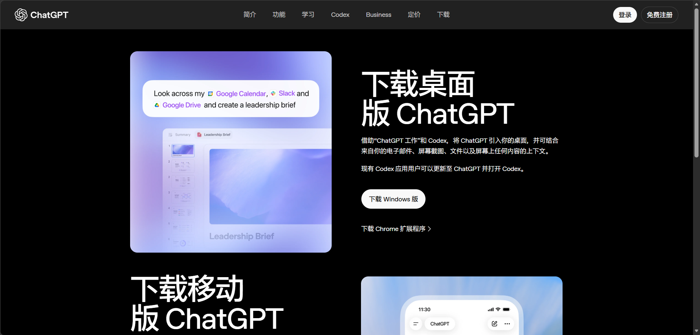

ChatGPT 官方下载页面中的 Windows 下载入口

### 2. 打开Windows安装程序

如果浏览器下载了安装程序，在下载列表中点击"打开文件"。截图中的文件名为 ChatGPT Installer.exe，实际名称可能不同；如果已直接进入 Microsoft Store，按商店页面提示继续即可，无需重复下载。

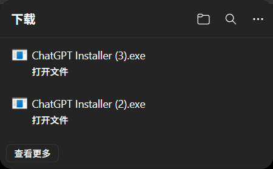

浏览器下载列表中的 ChatGPT Windows 安装程序

### 3. 完成安装并启动应用

在 Microsoft Store 中点击"安装"或"获取"，等待下载安装完成后打开 ChatGPT。下载速度取决于网络、商店服务和设备状态；如果进度停滞，可参考后文的微软商店下载失败排查。

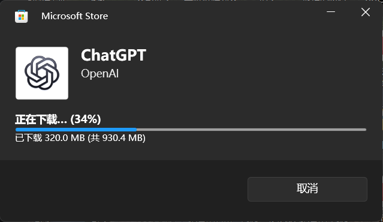

Microsoft Store 正在下载由 OpenAI 发布的 ChatGPT 应用


<a id="section-2"></a>

## 二、Mac版ChatGPT下载与安装

### 1. 选择macOS下载入口

在官方下载页面选择 macOS 版本。下载前请确认 Mac 的芯片类型和 macOS 版本符合页面要求；如果不符合客户端要求，可以先使用网页版。

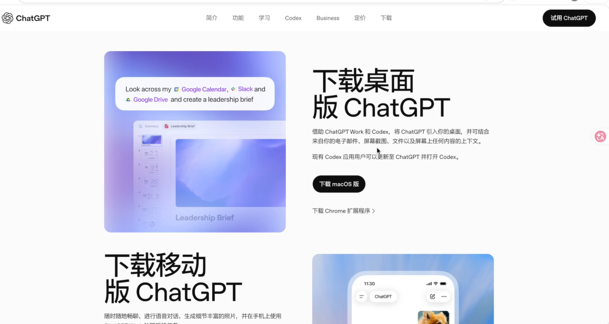

ChatGPT 官方下载页面中的 macOS 下载入口

### 2. 打开下载的DMG文件

下载完成后，在浏览器下载列表或"下载"文件夹中找到 .dmg 安装文件并打开。Mac 版无需通过 Microsoft Store 安装。

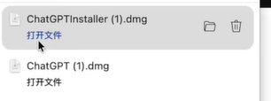

浏览器下载列表中的 ChatGPT DMG 安装文件

按照安装窗口提示完成安装；若窗口要求将 ChatGPT 拖入“应用程序”文件夹，按提示操作即可，然后从“应用程序”中启动。

### 3. 打开Mac客户端并登录

启动 ChatGPT 后按提示登录。部分登录步骤可能会跳转到浏览器完成，完成后按提示返回客户端。安装结束后停留在登录页面属于正常现象，并不代表安装失败。

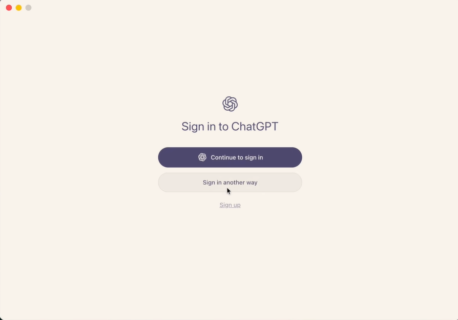

ChatGPT Mac 应用的登录界面

<a id="section-3"></a>

## 三、安装后如何开始使用ChatGPT电脑版

登录成功后，在输入框中输入问题并发送，就可以开始对话了。

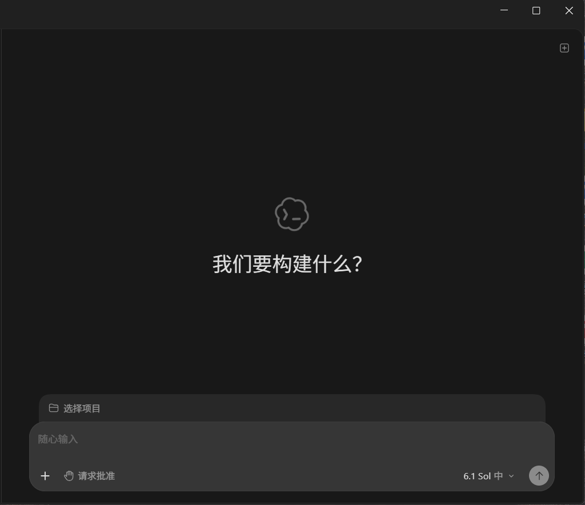

登录后的 ChatGPT 桌面应用聊天界面

<a id="section-4"></a>

## 四、ChatGPT电脑版常见问题

### 1. ChatGPT is unable to load怎么办？

这条提示表示应用未能正常加载，仅凭提示无法判断具体原因。建议按以下顺序排查：

退出并重新打开应用；

1.1检查设备网络连接是否正常、系统时间是否准确；

1.2更新客户端到最新版本；

1.3打开网页版对比，判断问题是否只出现在桌面应用。

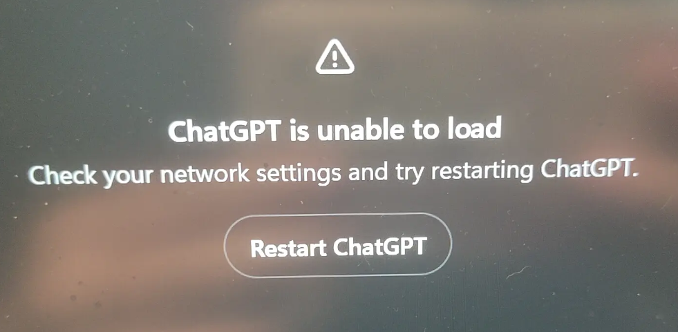

ChatGPT is unable to load 加载失败提示

如果仍然失败，检查防火墙或单位网络规则是否影响连接，并查看 OpenAI 服务状态及支持地区说明。

### 2. ChatGPT登录时要求验证手机号怎么办？

先确认当前页面属于官方登录流程，再按页面要求操作。并非每个账号、每次登录都会出现相同的验证步骤。建议使用本人长期可控的手机号，避免号码失效影响后续登录和账号找回。

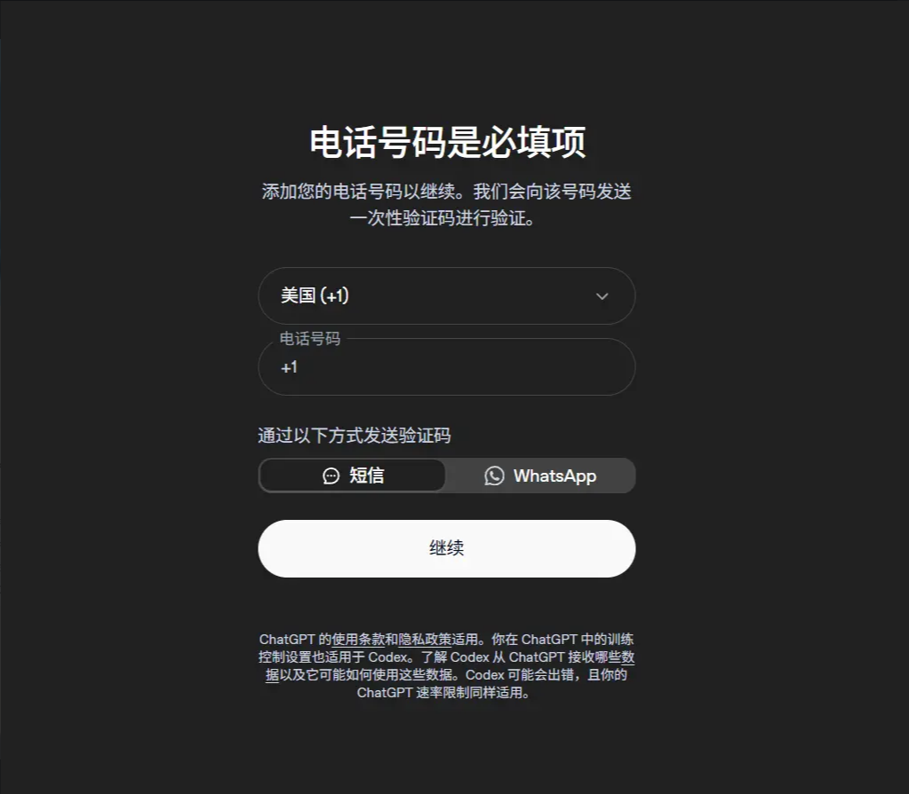

ChatGPT 账号出现电话号码验证要求的示例

不要将第三方会员代订服务写成官方接码渠道。若需要持续接收验证信息，应考虑号码的长期可控性，避免因临时号码失效影响后续登录与账号找回。

### 3. 微软商店下载ChatGPT失败怎么办（错误代码0x80080005）？

Microsoft Store 无法下载、长时间转圈或出现错误代码 0x80080005，可能涉及网络、缓存、系统组件等不同原因，建议按以下顺序排查。

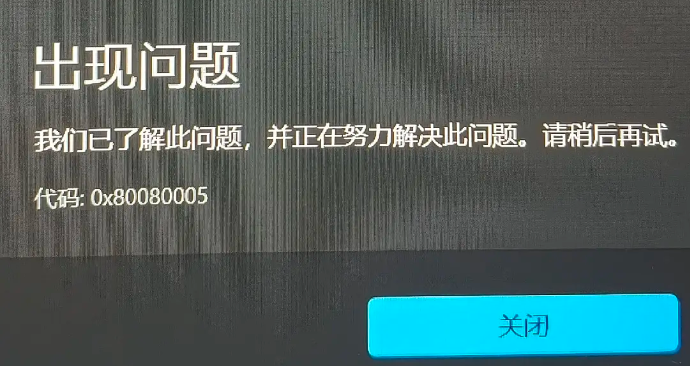

Microsoft Store 显示错误代码 0x80080005

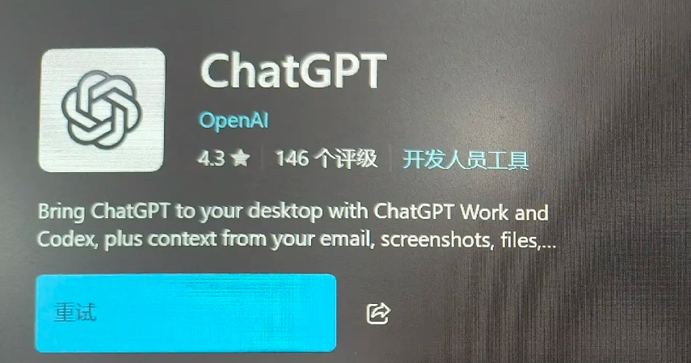

Microsoft Store 中 ChatGPT 应用的重试按钮

**第一步：检查网络和商店状态**
 重启 Microsoft Store 和电脑，检查网络连接、磁盘剩余空间和 Windows 更新状态。如果其他应用也无法下载，可以切换网络测试，并检查微软商店服务是否异常。不要随意填写虚假的账号或地区信息。

**第二步：清理Microsoft Store缓存**
 按 Win + R 打开"运行"，输入 wsreset.exe 后回车。命令会先显示一个空白窗口，稍后自动重新打开商店，完成后再次尝试下载。清理缓存可以解决部分异常，但不能保证修复所有问题。

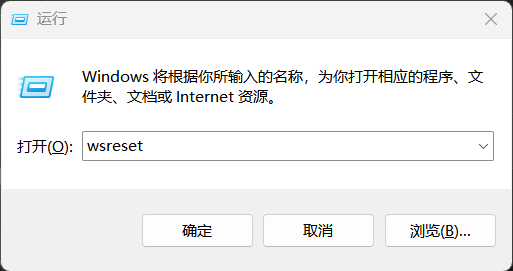

Windows 运行窗口中输入 wsreset 清理商店缓存

**第三步：修复Windows系统组件**
 如果多个商店应用都异常，且前两步无效，可以以管理员身份打开终端或 PowerShell，依次运行：

```powershell
DISM.exe /Online /Cleanup-image /Restorehealth
```

等待执行结束后，再运行：

```powershell
sfc /scannow
```

根据返回结果处理，必要时重启电脑后重试。如果仍然报错，记录错误代码、Windows 版本和已尝试的步骤，联系 Microsoft 支持。

### 4. 不安装客户端，可以在电脑上用ChatGPT吗？

可以。通过浏览器访问 [https://chatgpt.com/](https://chatgpt.com/) ，按官方流程登录即可使用网页版。网页版和桌面客户端的功能可能略有差异，以实际界面为准。

<a id="section-5"></a>

## 总结

以上就是 2026 年最新的 ChatGPT电脑版下载安装教程。Windows 用户通过官网或 Microsoft Store 安装，Mac 用户下载 DMG 文件安装，登录后即可使用。遇到加载失败或商店下载报错，按文中步骤逐一排查，大部分问题都能解决。觉得有用的话，欢迎收藏分享。

如果你想要了解如何订阅ChatGPT会员，可以通过Wildai进行订阅——

传送门：[https://bewild.ai/?code=1103](https://bewild.ai/?code=1103)


## 订阅与相关阅读

[前往 WildAI](https://bewild.ai/?code=1103)。注册时填写邀请码 **1103**，可享 **1 美元优惠**；适用范围和实付金额以当前结算页为准。该链接为推荐链接。请勿将密码、验证码或 Session 等登录凭据发到公开页面。

- [ChatGPT 注册教程](https://github.com/ai-subscription-guide/chatgpt-plus-guide/blob/main/guides/chatgpt-register.md)
- [ChatGPT 手机版下载教程](https://github.com/ai-subscription-guide/chatgpt-plus-guide/blob/main/guides/chatgpt-download-mobile.md)
- [ChatGPT 订阅与支付指南](https://github.com/ai-subscription-guide/chatgpt-plus-guide)
