# 2026最新ChatGPT手机版下载教程：安卓和iPhone官方安装步骤详解（附常见问题）

> 整理更新：2026-10-29。保留原稿操作配图；截图中的旧价格、邀请码和界面仅供参考，以当前页面为准。

## 本文目录

- [一、下载前的准备](#section-1)
- [二、安卓手机下载ChatGPT的步骤](#section-2)
- [三、苹果iPhone下载ChatGPT的步骤](#section-3)
- [四、ChatGPT手机版常见问题](#section-4)
- [五、如何注册苹果美区ID](#section-5)

很多人想在手机上使用 ChatGPT，却不知道从哪里下载、怎么分辨官方应用。

本文是一篇 ChatGPT 手机版下载安装教程，分别讲解安卓手机和苹果 iPhone 的官方下载步骤，帮你避开山寨应用，顺利装上 ChatGPT App。

简单来说：安卓手机通过 Google Play 下载，iPhone 通过 App Store 下载，安装完成后用 ChatGPT 账号登录即可。

## 一、下载前的准备

**应用商店账号**：安卓需要 Google 账号登录 Google Play，iPhone 需要 外区的Apple 账户登录 App Store。

**ChatGPT 账号**：安装后用于登录，没有的话可以在 App 内按提示注册。

**所在地区**：ChatGPT App 只在 OpenAI 支持的国家和地区上架，所在地区不支持时，应用商店里会搜不到。

**官方下载页**：[https://chatgpt.com/zh-Hans-CN/download/](https://chatgpt.com/zh-Hans-CN/download/) ，从这里跳转可以直接到达官方应用页面，最不容易下错。

## 二、安卓手机下载ChatGPT的步骤

### 1. 安装谷歌三件套和Google Play

国行安卓手机大多没有预装 Google Play，需要先装好**谷歌三件套**：Google 服务框架、Google Play 服务、Google Play 商店。如果你的手机里已经有能正常使用的"Play 商店"，可以直接跳到第2步。

### 1.1 先看系统有没有自带开关（推荐）

部分国行手机在系统设置里自带"Google 基础服务"之类的开关，打开后再安装 Google Play 即可，这是最省事也最安全的方式。可以在设置里搜索"谷歌"或"Google"试试。

### 1.2 使用 GO 安装器一键安装

**下载 GO 安装器**：下载安装包，按提示完成安装。建议优先从手机自带应用商店或可信渠道获取，安装前留意来源。

传送门:https://www.pgyer.com/pOEI

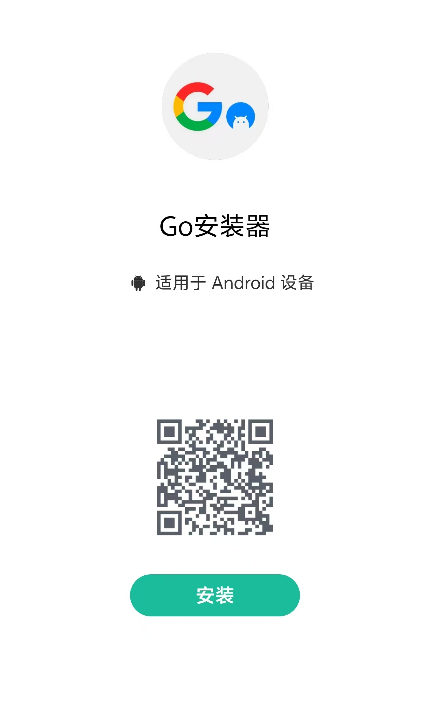

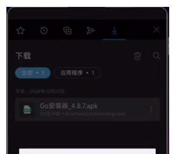

图 1  Go 安装器页面与安装完成提示

**授予权限**：首次打开会弹出权限说明，仔细阅读后点击授权。

**检测组件**：进入首页找到"必备套件"列表，检查 Google 服务框架、Google Play 服务、Google Play 商店的状态。

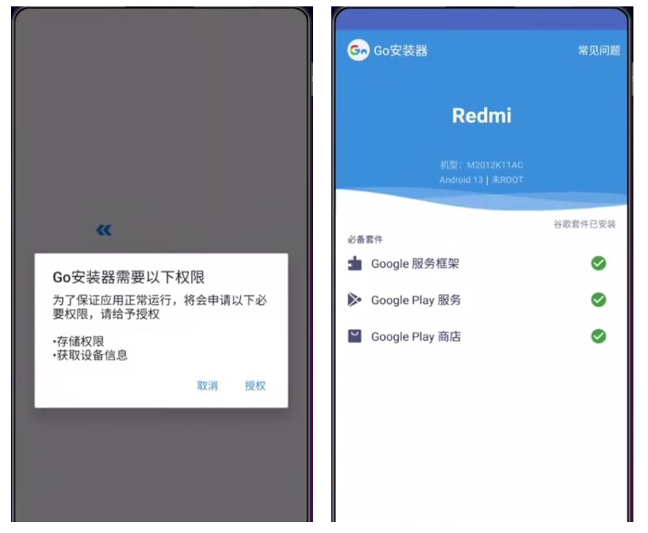

图 2  首次权限提示与组件检测列表

**一键补齐**：如果显示套件不完整，点击右侧"一键安装"，等待安装器补齐缺少的组件；如果显示已安装，无需重复安装。

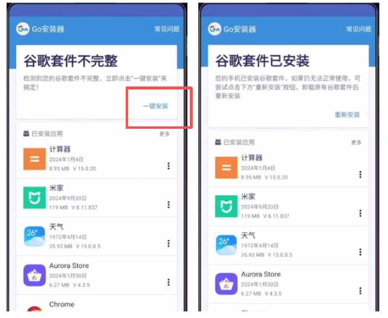

图 3  一键安装与重新安装入口

**找到 Google Play 商店**：安装完成后，在桌面找到"Play 商店"，图标是彩色三角形。

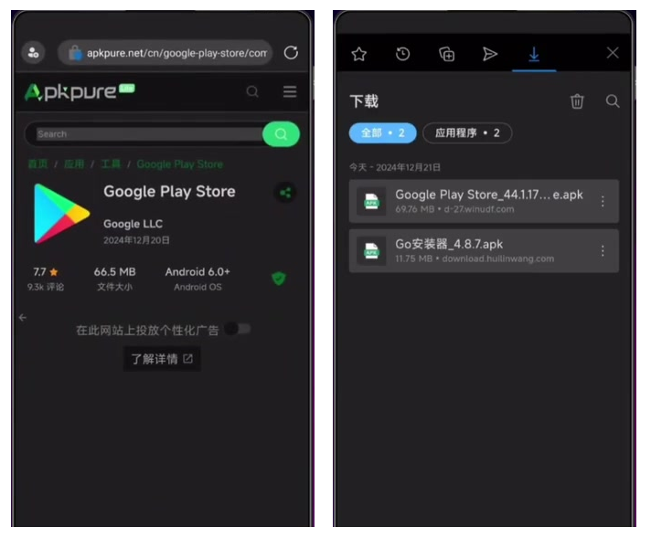

图 4  Google Play Store 页面

**登录 Google 账号**：确认手机网络可以访问 Google 服务后，打开 Play 商店，登录自己的 Google 账号，按页面完成验证并阅读条款。

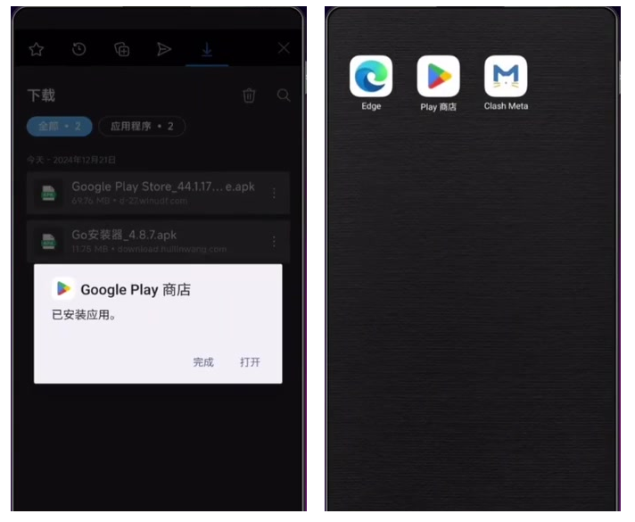

**测试下载**：随便搜索一个应用点击安装，能正常下载就说明 Google Play 已经可以使用了。

注意：华为部分新机型（如纯血鸿蒙系统）无法安装谷歌三件套，可以改用网页版 ChatGPT。

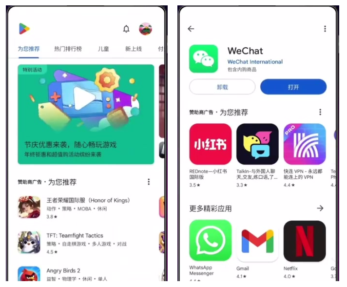

图 6  商店首页与已安装应用页面

### 2. 搜索ChatGPT并核对官方应用

在 Google Play 搜索栏输入"ChatGPT"，找到开发者为 OpenAI 的应用。商店里有不少名字相似的仿冒应用，一定要核对开发者名称。

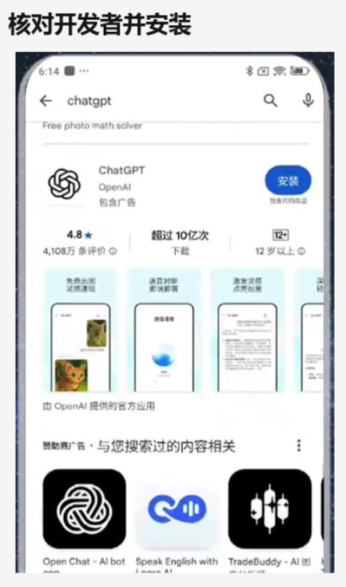

Google Play搜索ChatGPT官方应用OpenAI

### 3. 点击安装并登陆

点击“安装”，等待下载和安装完成。

随后进入欢迎页后，选择登录方式。如果你原来有账号，可以直接开始使用。如果你没有账号，按照提示进行注册。

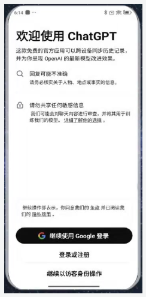

ChatGPT安卓App登录页面

## 三、苹果iPhone下载ChatGPT的步骤

### 1.  打开App Store，确认账号

在 iPhone 上打开 App Store，点击右上角头像查看当前登录的 Apple 账户。App Store 能下载哪些应用由账户所在地区决定，如果该地区没有上架 ChatGPT，就无法搜到。

### 2. 搜索ChatGPT，选择官方应用

进入"搜索"页，输入"ChatGPT"，确认开发者为 **OpenAI**。

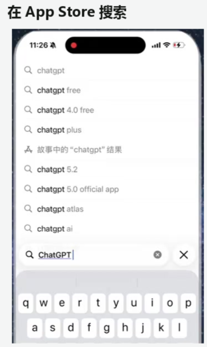

App Store搜索ChatGPT官方应用

### 3. 点击获取并完成下载

在应用详情页点击“获取”；使用 Face ID、Touch ID 或 Apple 账户验证，等待安装完成。

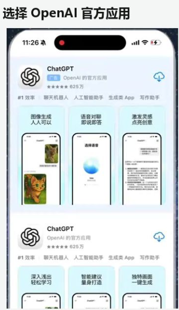

App Store下载ChatGPT获取按钮

### 4. 打开ChatGPT并登录

点击"打开"，按欢迎页的提示登录或注册账号。

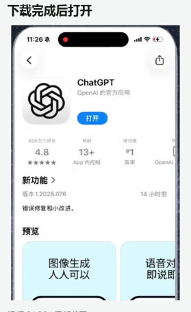

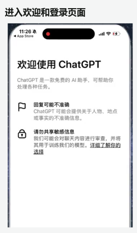

如果你想要了解如何订阅ChatGPT会员，可以通过Wildai进行订阅——

传送门：[https://bewild.ai/?code=1103](https://bewild.ai/?code=1103)

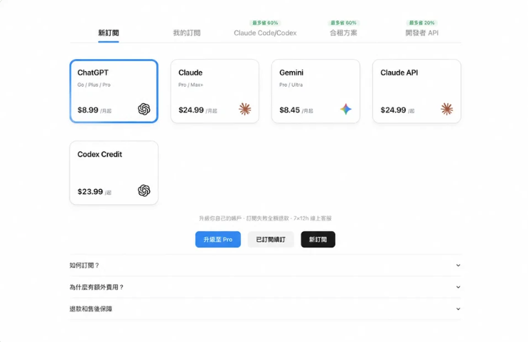

## 四、ChatGPT手机版常见问题

### 1. 下载ChatGPT手机版需要付费吗？

不需要。ChatGPT App 可以免费下载和使用，Plus 等付费订阅是可选项，可以先用免费版，有需要再在 App 内通过官方渠道订阅。

### 2. 安卓手机怎么安装谷歌三件套？

优先在系统设置里查找是否有自带的 Google 服务开关；没有的话，可以使用 GO 安装器一键检测和补齐，具体步骤见本文第二部分第1步。

### 3. App Store或Google Play搜不到ChatGPT怎么办？

先从官方下载页跳转到应用商店，确认搜索的是正确的应用。如果还是搜不到，通常是账号所在地区没有上架 ChatGPT，或者设备系统版本不满足要求。安卓用户还要确认 Google Play 能否正常运行。

### 4. 怎么分辨ChatGPT官方应用和山寨应用？

最可靠的方法是看开发者：官方 ChatGPT 应用的开发者是 **OpenAI**。名字里带"AI 助手"”Chat"但开发者不是 OpenAI 的，都不是官方应用。

### 5. 安装后打不开或一直加载怎么办？

依次检查网络连接、系统时间是否准确、手机存储空间是否充足，然后把应用更新到最新版本再试。安卓手机还要确认 Google Play 服务是否正常。

### 6. 手机版和电脑版的账号通用吗？

通用。同一个 ChatGPT 账号可以在手机 App、电脑客户端和网页版登录，聊天记录会同步。

## 五、如何注册苹果美区ID

### 1.首先打开苹果官网 点击创建我的apple 账户

传送门：account.apple.com

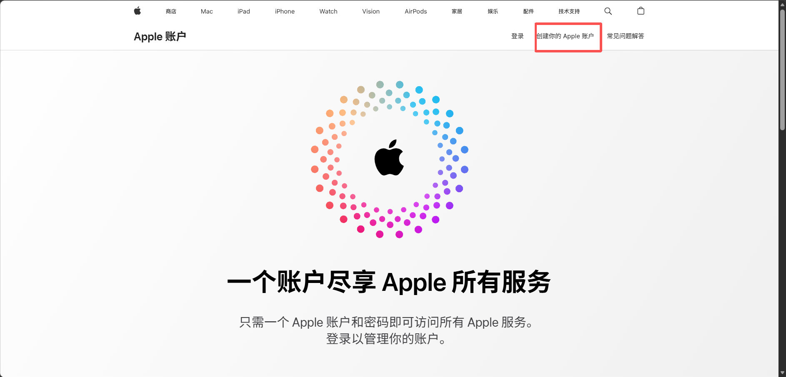

### 2.填写基本信息

填写你的姓名，出生日期等。国家或地区、出生日期等请填写本人真实信息，并使用可以正常接收邮件的邮箱

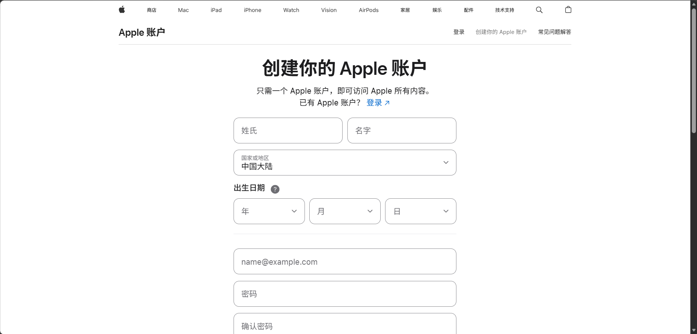

### 3.登录自己的账户

首先打开apple store 点击右上角的头像，登录自己刚注册的国区id

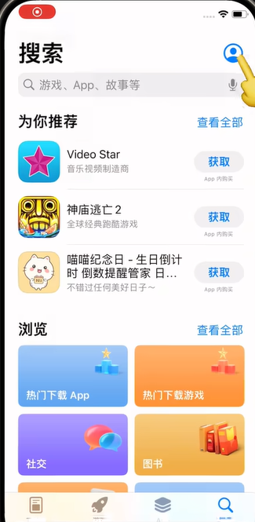

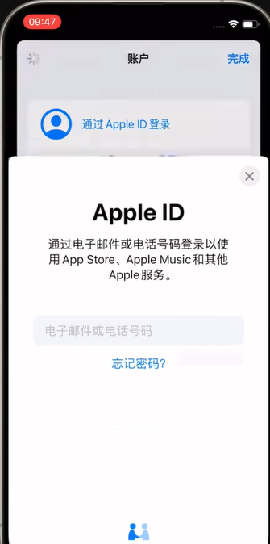

### 4.更改地区

进入账户设置，点击国家和地区，选择美国

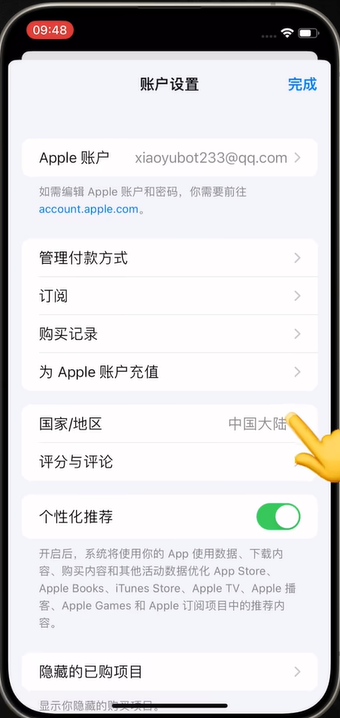

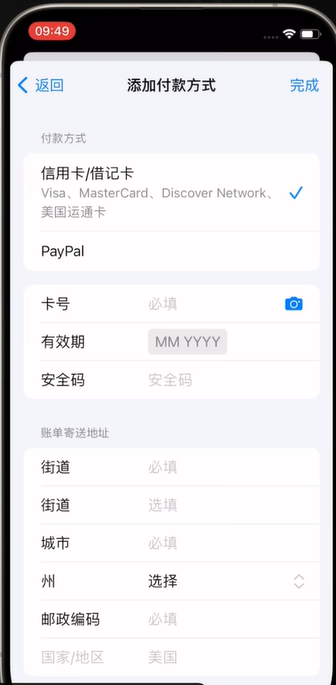

### 5.选择付款方式

可选付款方式由账号和地区等条件决定；如果没有“无”，请按 Apple 当前提示处理，不保证更换网络就会出现。

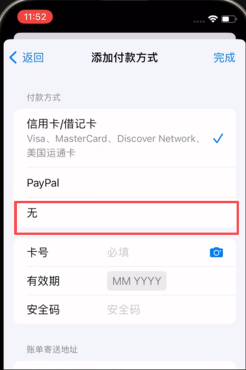

### 6.填写账单地址

账单地址应填写真实、有效且与付款资料相符的信息，不要使用随机生成的地址。更改地区前请先阅读 Apple 的要求：https://support.apple.com/zh-cn/118283 。

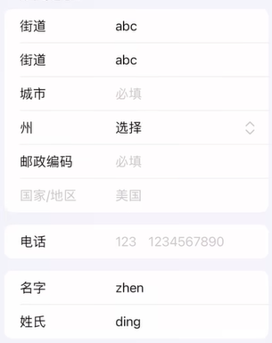

完成以上的动作就弄好了！

如果你想要了解如何订阅ChatGPT会员，可以通过Wildai进行订阅——

传送门：[https://bewild.ai/?code=1103](https://bewild.ai/?code=1103)

## 订阅与相关阅读

[前往 WildAI](https://bewild.ai/?code=1103)。注册时填写邀请码 **1103**，可享 **1 美元优惠**；适用范围和实付金额以当前结算页为准。该链接为推荐链接。请勿将密码、验证码或 Session 等登录凭据发到公开页面。

- [ChatGPT 注册教程](https://github.com/ai-subscription-guide/chatgpt-plus-guide/blob/main/guides/chatgpt-register.md)
- [ChatGPT 电脑版下载教程](https://github.com/ai-subscription-guide/chatgpt-plus-guide/blob/main/guides/chatgpt-download-desktop.md)
- [ChatGPT 订阅与支付指南](https://github.com/ai-subscription-guide/chatgpt-plus-guide)
