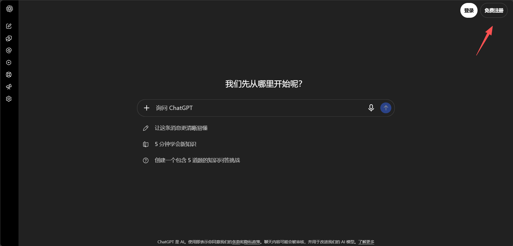
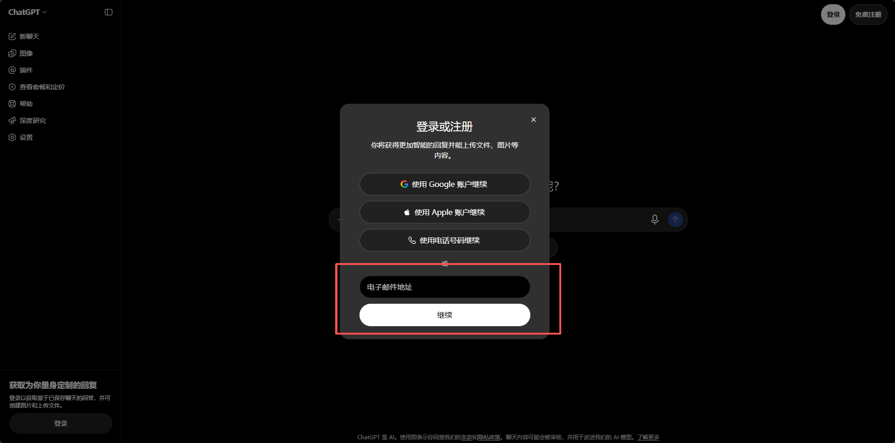
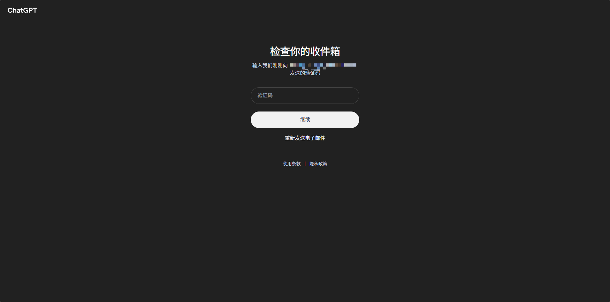
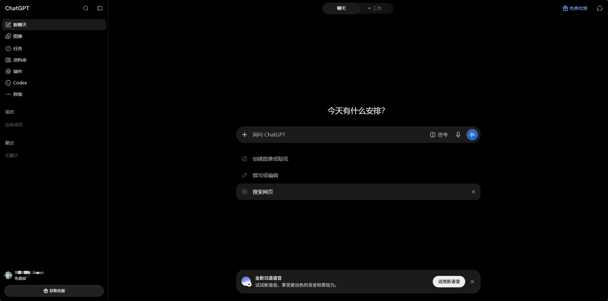

# 2026最新ChatGPT注册方法：邮箱注册全流程，小白也能学会

> 整理更新：2026-10-29。保留原稿操作配图；截图中的旧价格、邀请码和界面仅供参考，以当前页面为准。

## 本文目录

- [一、登录Chatgpt官网 ](#section-1)
- [二、输入验证码](#section-2)
- [三、注册成功](#section-3)

在AI的时代浪潮，很多人想尝试使用chatgpt帮助自己提高效率，今天附上一篇图文教程，手把手教会你如何注册Chatgpt。

## 一、登录Chatgpt官网

打开官网，选择Apple账户或者电话号码，邮箱免费注册。这里我们使用邮箱注册。（建议使用outlook邮箱）

注意：登录官网要魔法梯子

官网传送门：https://chatgpt.com/

## 二、输入验证码

当你填写完自己的邮箱，官网会发送一个验证码到对应邮箱，点卡邮箱查看并输入验证码等待验证

## 三、注册成功

输入完验证码等待验证后，系统就会提示注册成功，如下图，就可以使用免费版本的chatgpt啦

以上就是文章的全部内容，感谢观看。

如果你想要了解如何订阅ChatGPT会员，可以看我之前的文章——

如果你想要了解如何订阅ChatGPT会员，可以通过Wildai进行订阅——

传送门：[https://bewild.ai/?code=1103](https://bewild.ai/?code=1103)

## 订阅与相关阅读

[前往 WildAI](https://bewild.ai/?code=1103)。注册时填写邀请码 **1103**，可享 **1 美元优惠**；适用范围和实付金额以当前结算页为准。该链接为推荐链接。请勿将密码、验证码或 Session 等登录凭据发到公开页面。

- [ChatGPT 手机版下载教程](https://github.com/ai-subscription-guide/chatgpt-plus-guide/blob/main/guides/chatgpt-download-mobile.md)
- [ChatGPT 电脑版下载教程](https://github.com/ai-subscription-guide/chatgpt-plus-guide/blob/main/guides/chatgpt-download-desktop.md)
- [ChatGPT 订阅与支付指南](https://github.com/ai-subscription-guide/chatgpt-plus-guide)
